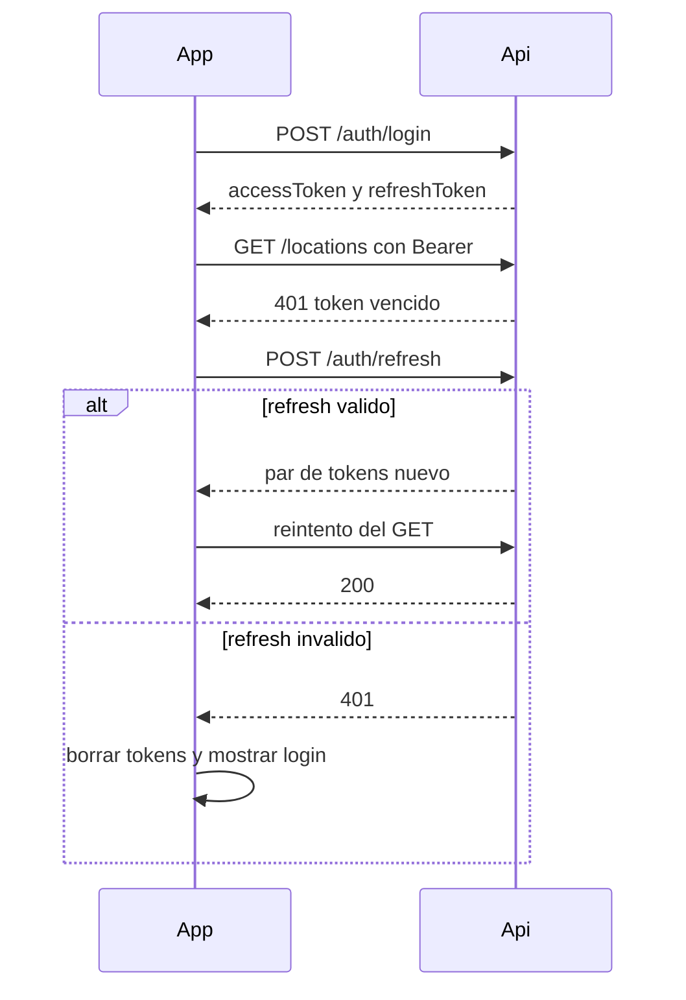

# API móvil de AssetCore

Contrato para la app que consulta activos. Usa los mismos usuarios que la web. No usa cookies: los tokens van en JSON y en el header `Authorization`.

Base:

```
https://activo.combuexpress.com.mx/api/mobile
```

Todas las respuestas son JSON. Las rutas de datos piden el permiso `assets.read`.

## Autenticación

El access token dura 15 minutos. El campo `expiresIn` viene en segundos (900). El refresh token dura 7 días.

Guardar ambos en el almacén seguro del dispositivo (Keychain en iOS, Keystore en Android). En React Native: `expo-secure-store`. En Flutter: `flutter_secure_storage`. No usar AsyncStorage ni SharedPreferences en claro.

### POST /auth/login

Sin token. Máximo 10 intentos por minuto.

```json
{ "email": "usuario@combu-express.com.mx", "password": "********" }
```

```json
{
  "accessToken": "<jwt>",
  "refreshToken": "<opaco>",
  "expiresIn": 900,
  "user": {
    "id": 1,
    "fullName": "Nombre Apellido",
    "email": "usuario@combu-express.com.mx",
    "role": { "id": 1, "name": "Admin" }
  },
  "permissions": ["assets.read", "assets.write"]
}
```

La respuesta no incluye menús de la web. `400` si falta email o password. `401` si las credenciales son incorrectas: `{ "message": "Credenciales inválidas" }`.

### POST /auth/refresh

Máximo 30 por minuto. Cada refresh invalida el token anterior y entrega uno nuevo.

```json
{ "refreshToken": "<opaco>" }
```

```json
{
  "accessToken": "<jwt nuevo>",
  "refreshToken": "<opaco nuevo>",
  "expiresIn": 900,
  "user": {
    "id": 1,
    "fullName": "Nombre Apellido",
    "email": "usuario@combu-express.com.mx",
    "role": { "id": 1, "name": "Admin" }
  }
}
```

Reglas:

1. Guardar siempre el `refreshToken` nuevo y borrar el anterior antes de la siguiente llamada.
2. Hacer un solo refresh a la vez. Si varias peticiones reciben 401, encolarlas detrás de la misma renovación.
3. Reusar un refresh token ya rotado cierra toda la sesión. El servidor responde `401` y la app debe volver al login.

### POST /auth/logout

```json
{ "refreshToken": "<opaco>" }
```

```json
{ "message": "Sesión cerrada" }
```

Borrar los tokens locales aunque la red falle. `400` si el cuerpo no trae `refreshToken`.

### Flujo de sesión



## Ubicaciones

### GET /locations

Header: `Authorization: Bearer <accessToken>`.

```json
{
  "locations": [
    { "id": 1, "name": "Matriz", "parentId": null, "path": "Matriz" },
    { "id": 4, "name": "Almacen", "parentId": 1, "path": "Matriz > Almacen" }
  ]
}
```

Solo ubicaciones activas, ordenadas por nombre. `path` une los nombres con ` > `.

## Activos de una ubicación

### GET /locations/:id/assets

Query opcional: `includeChildren=true` o `includeChildren=false`. Si se omite, solo la ubicación exacta.

No incluye activos con estatus `SCRAP`. Orden: `assetCode` ascendente. `404` si la ubicación no existe o está inactiva: `{ "message": "Ubicación no encontrada" }`.

```json
{
  "location": { "id": 1, "name": "Matriz", "path": "Matriz" },
  "assets": [
    {
      "id": 2,
      "assetCode": "LAP-0001",
      "brand": "Dell",
      "model": "Latitude",
      "serialNumber": "SN123",
      "status": "ASSIGNED",
      "assetType": "Laptop",
      "assignedToName": "Ana López",
      "description": "Proyecto Norte",
      "locationPath": "Matriz > Almacen"
    }
  ]
}
```

`id` es el mismo valor del QR. `assetType`, `assignedToName`, `description` y `locationPath` pueden ser `null`.

## Detalle de un activo

### GET /assets/:id

El `id` sale del listado o del QR. Devuelve el activo con cualquier estatus, incluido `SCRAP`, para que un QR de un equipo dado de baja siga mostrando datos. `404`: `{ "message": "Activo no encontrado" }`.

```json
{
  "asset": {
    "id": 2,
    "assetCode": "LAP-0001",
    "brand": "Dell",
    "model": "Latitude",
    "serialNumber": "SN123",
    "status": "ASSIGNED",
    "assetType": "Laptop",
    "processor": "Intel Core i5",
    "ramGb": 16,
    "storageGb": 512,
    "storageType": "SSD",
    "purchaseDate": "2024-03-01T00:00:00.000Z",
    "warrantyEnd": "2027-03-01T00:00:00.000Z",
    "endOfLifeDate": null,
    "assignedToName": "Ana López",
    "assignedToDate": "2024-04-10T00:00:00.000Z",
    "description": "Proyecto Norte",
    "location": { "id": 4, "name": "Almacen", "path": "Matriz > Almacen" },
    "specifications": {}
  }
}
```

Fechas en ISO 8601 UTC. Mostrarlas en la app como `dd/mm/aaaa`. `location` es `null` si el activo no tiene ubicación. `specifications` es un objeto JSON libre.

### Campos

| Campo | Tipo | Notas |
|---|---|---|
| `id` | number | Identificador del QR |
| `assetCode` | string | Código visible, único |
| `status` | `AVAILABLE` \| `ASSIGNED` \| `MAINTENANCE` \| `SCRAP` | Ver etiquetas en la guía de diseño |
| `assetType` | string \| null | Nombre del tipo, no el id |
| `storageType` | `SSD` \| `HDD` \| `NVME` \| null | Solo en el detalle |
| `ramGb`, `storageGb` | number \| null | Solo en el detalle |
| `purchaseDate`, `warrantyEnd`, `endOfLifeDate`, `assignedToDate` | string ISO \| null | Solo en el detalle |
| `description` | string \| null | Máximo 40 caracteres. Proyecto o site |
| `locationPath` | string \| null | Solo en el listado |
| `location` | `{ id, name, path }` \| null | Solo en el detalle |
| `specifications` | object | Solo en el detalle |

## Código QR

Texto del QR, generado por la web:

```json
{"t":"asset","v":1,"id":123,"c":"LAP-0001"}
```

| Campo | Uso |
|---|---|
| `t` | Debe ser `"asset"` |
| `v` | Debe ser `1` |
| `id` | Llamar `GET /assets/:id` |
| `c` | Código para mostrar mientras carga el detalle |

Si el texto no es ese JSON, o `t` / `v` no coinciden, mostrar "QR no reconocido" y no llamar a la API.

## Errores

Todas las fallas usan `{ "message": "..." }`.

| HTTP | Cuándo | Qué hace la app |
|---|---|---|
| 400 | Cuerpo o query inválidos. `"Datos inválidos"` | Corregir la petición. No reintentar igual |
| 401 | Sin token, token vencido o credenciales mal. `"Token no proporcionado"`, `"Token invalido o expirado"`, `"Credenciales inválidas"`, `"Refresh token inválido"` | En datos: un refresh y reintento. Si el refresh falla: borrar tokens y login con "Tu sesión expiró. Inicia sesión de nuevo." |
| 403 | Usuario sin `assets.read`. `"Sin permisos suficientes"` | Pantalla de acceso denegado. No reintentar |
| 404 | Ubicación o activo inexistente | Mensaje del `message` y volver atrás |
| 429 | Demasiados login o refresh | Esperar y mostrar el `message` |
| 500 | Error interno. `"Error interno del servidor"` | "Reintentar" |

## Ejemplos curl

```bash
BASE=https://activo.combuexpress.com.mx/api/mobile

curl -s -X POST "$BASE/auth/login" \
  -H "Content-Type: application/json" \
  -d '{"email":"USUARIO","password":"CONTRASENA"}'

curl -s -X POST "$BASE/auth/refresh" \
  -H "Content-Type: application/json" \
  -d '{"refreshToken":"REFRESH"}'

curl -s "$BASE/locations" \
  -H "Authorization: Bearer TOKEN"

curl -s "$BASE/locations/4/assets?includeChildren=true" \
  -H "Authorization: Bearer TOKEN"

curl -s "$BASE/assets/2" \
  -H "Authorization: Bearer TOKEN"
```

## Guía de diseño

La web usa Material 3. La app debe usar los mismos tokens, no colores sueltos. Fuente de verdad: `frontend/src/index.css`.

### Marca

Logo: `frontend/public/logo-combu-express.png`. Es un wordmark ancho con fondo blanco opaco. En claro puede ir directo. En oscuro va sobre una placa blanca con radio 16 px, igual que el sidebar web. No recortar el wordmark ni teñirlo.

### Tipografía

Inter, pesos 400, 500, 600 y 700. Fallback: system sans-serif.

| Uso | Tamaño | Peso |
|---|---|---|
| Título de pantalla | 24 | 600 |
| Título de sección | 16 | 600 |
| Cuerpo | 14 | 400 |
| Etiqueta y metadato | 12 | 500 |
| Código de activo | 16 | 600 |

### Color

Modo oscuro: seguir el ajuste del sistema. Mismos tokens del bloque `.dark` de la web.

| Token | Claro | Oscuro | Uso |
|---|---|---|---|
| primary | `#4f6ef7` | `#b4c5ff` | Botones, foco, links |
| on-primary | `#ffffff` | `#002b75` | Texto sobre primary |
| primary-container | `#dce1ff` | `#1d3f97` | Chip Disponible, item activo |
| on-primary-container | `#001552` | `#dce1ff` | Texto de ese chip |
| secondary | `#585e71` | `#bfc6dc` | Acentos neutros |
| secondary-container | `#dce1f9` | `#3f4759` | Chip Asignado |
| on-secondary-container | `#161b2c` | `#dce1f9` | Texto de ese chip |
| tertiary | `#8b5cf6` | `#cfbcff` | Acento violeta |
| tertiary-container | `#e9ddff` | `#4f378b` | Chip Mantenimiento |
| on-tertiary-container | `#381e72` | `#e9ddff` | Texto de ese chip |
| error | `#ba1a1a` | `#ffb4ab` | Errores y acciones destructivas |
| error-container | `#ffdad6` | `#93000a` | Chip Baja |
| on-error-container | `#410002` | `#ffdad6` | Texto de ese chip |
| background | `#faf8ff` | `#121318` | Fondo de pantalla |
| surface | `#faf8ff` | `#121318` | Base |
| surface-container-lowest | `#ffffff` | `#0d0e13` | Tarjeta |
| surface-container-low | `#f4f3fa` | `#1c1b21` | Lista, barra de filtros |
| on-surface | `#1b1b21` | `#e5e1e9` | Texto principal |
| on-surface-variant | `#45464f` | `#c6c5d0` | Texto secundario |
| outline | `#767680` | `#908f9a` | Bordes fuertes |
| outline-variant | `#c6c5d0` | `#45464f` | Bordes de tarjeta |

### Forma

| Elemento | Radio |
|---|---|
| Botón y campo | 12 px |
| Tarjeta y chip | 16 px |
| Hoja o modal | 20 px |

Borde de tarjeta: 1 px `outline-variant`. Sombra suave, equivalente a la web: 1 px de blur y 4% de negro en reposo; un poco más al presionar. No usar sombras duras.

### Estatus

Misma etiqueta y mismo contenedor que la web.

| Valor | Etiqueta | Fondo | Texto |
|---|---|---|---|
| `AVAILABLE` | Disponible | primary-container | on-primary-container |
| `ASSIGNED` | Asignado | secondary-container | on-secondary-container |
| `MAINTENANCE` | Mantenimiento | tertiary-container | on-tertiary-container |
| `SCRAP` | Baja | error-container | on-error-container |

### Iconos

Lucide, trazo 2. En React Native: `lucide-react-native`. En Flutter: `lucide_icons`.

| Pantalla | Icono |
|---|---|
| Ubicación | `MapPin` |
| Equipo | `Monitor` |
| Escanear | `QrCode` |
| Responsable | `User` |
| Fechas | `Calendar` |

### Textos

Español, el mismo vocabulario de la web: Activo, Ubicación, Responsable, Descripción, Número de serie, Marca, Modelo, Procesador, RAM, Almacenamiento. No inventar sinónimos (no "device", no "site" como título).

### Pantallas

1. **Login.** Placa con el logo, campo Correo, campo Contraseña, botón "Iniciar sesión" en primary. Error de credenciales bajo el formulario, color error.
2. **Ubicaciones.** Lista con buscador. Cada fila: nombre (`on-surface`) y `path` (`on-surface-variant`).
3. **Activos.** Switch "Incluir sububicaciones" (equivale a `includeChildren=true`). Tarjeta: `assetCode`, marca y modelo, responsable, chip de estatus. Toque abre el detalle con `id`.
4. **Detalle.** Secciones General (`assetCode`, tipo, estatus, descripción), Hardware (procesador, RAM, almacenamiento), Responsable (nombre y fecha) y Ubicación (`location.path`). Omitir la línea si el campo es null.
5. **Escáner.** Botón flotante con `QrCode` sobre la lista de activos. Al leer, validar el JSON y abrir el detalle.

### Estados de interfaz

| Estado | Qué mostrar |
|---|---|
| Cargando | Spinner y el texto "Cargando..." |
| Lista vacía | "Sin activos en esta ubicación" |
| Error de red | Mensaje y botón "Reintentar" |
| Sesión expirada | Volver al login y mostrar "Tu sesión expiró. Inicia sesión de nuevo." |
